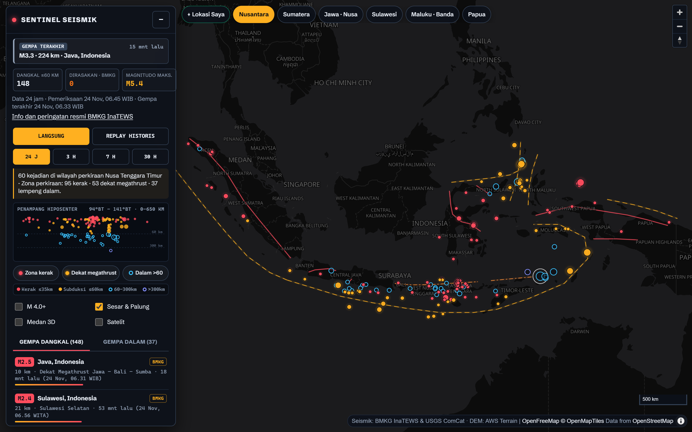
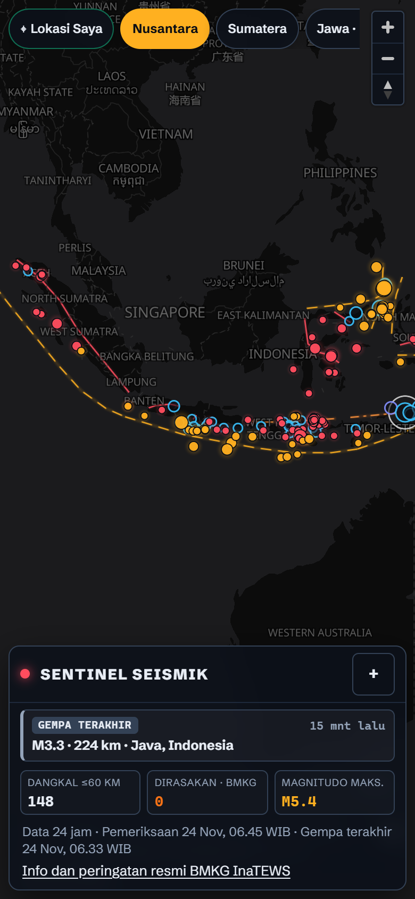

# Sentinel Seismik · Indonesia Earthquake & Active Fault 3D Monitor

**Real-time 3D Indonesian earthquake observatory fusing BMKG InaTEWS (SeisComP + MMI felt reports) and USGS ComCat — labelling events with approximate shallow crustal, subduction megathrust, and deep Wadati–Benioff intraslab zones, with a live hypocenter cross-section.**

[](https://quake.transbulent.id/)
[](https://inatews.bmkg.go.id/)
[](https://maplibre.org/)
[](https://workers.cloudflare.com/)
[](LICENSE)



---

## Why This Exists

Standard earthquake maps plot every tremor as an undifferentiated dot—equating a **10 km shallow crustal rupture** directly beneath a city (such as Cianjur, Bantul, or Palu) with a **450 km deep Wadati–Benioff intraslab earthquake** beneath the Banda Sea whose seismic energy attenuates strongly before reaching the surface.

**Sentinel Seismik** fuses near-real-time Indonesian seismograph bulletins with physics-aware tectonic classification across **16 mapped Indonesian fault, back-arc thrust, and subduction megathrust systems**, surfacing BMKG felt-intensity reports (`MMI`), approximate radiated energy (`Gutenberg–Richter`), and an interactive **0–650 km hypocenter depth cross-section** in one WebGL observatory. The earthquake list and detail dialog also work when WebGL or the basemap is unavailable. Tectonic-zone labels are approximate classifications from location and depth, not statements about an earthquake's cause. Sentinel Seismik is not an early-warning system.

<details>
<summary>Mobile responsive preview (390×844 viewport with collapsible control sheet)</summary>

<p align="center">
  
</p>

</details>

---

## Key Capabilities

- **Multi-Source Live Catalog Fusion (5-Minute Cron)**: Merges **BMKG InaTEWS SeisComP** near-real-time feeds (`live30event.xml`, `gempaQL.json`, `M ≥ 2.0`), BMKG felt-intensity reports and catalogue notes (`autogempa`, `gempadirasakan`, `gempaterkini`), and **USGS ComCat** 30-day seismicity (`M ≥ 2.5`) inside `94.0°E–141.2°E`, `11.8°S–7.0°N`. Duplicate reports within `≤ 95 km`, `±120 s`, and `ΔM ≤ 0.9` are automatically fused, preserving USGS event IDs enriched with BMKG `MMI` and `Wilayah` metadata. The BMKG `potensi` text is shown only in the detail of live events, labelled as a BMKG catalogue note and **not an active warning**; the USGS `tsunami` flag is not published, and there is no tsunami badge or prioritisation. The **`Dirasakan · BMKG`** count comes from BMKG felt reports.
- **3-Regime Tectonic Classification**:

| Regime | Visual Marker | Depth / Geometry Rule | Hazard Context |
| :--- | :--- | :--- | :--- |
| **Crustal Fault (`Sesar · Kerak`)** | `#ff4d5e` Crimson | Depth `≤ 35 km` and within `≤ 55 km` of a crustal/back-arc fault (or `> 95 km` from megathrust) | High near-field shaking risk on land (e.g., *Semangko*, *Cimandiri–Lembang–Baribis*, *Opak*, *Palu-Koro*, *Sorong*) |
| **Megathrust (`Subduksi`)** | `#ffb020` Amber | Depth `≤ 60 km` along trench/subduction interface | Interplate rupture context (*Sunda*, *Jawa–Sumba*, *Banda*, *Sulawesi Utara*, *Halmahera*); proximity to a structure is not proof of cause |
| **Deep Intraslab (`Lempeng Dalam`)** | `#38bdf8` / `#818cf8` Rings | Depth `> 60 km` (`60–300 km` intermediate, `> 300 km` deep Benioff up to `650 km`) | Deep subducted slab events with broader attenuation before reaching surface |

*Regime labels are approximate classifications derived from epicentre location and depth; the nearest mapped fault or trench is not evidence of the earthquake's cause. Official tsunami warnings come only from BMKG InaTEWS.*

- **Live Hypocenter Cross-Section (`94°E–141°E × 0–650 km`)**: Interactive SVG longitude-vs-depth profile showing the dipping Wadati–Benioff slab geometry synced with active tectonic regime filters and magnitude thresholds.
- **Edge-Optimized Cloudflare Worker + D1**: Performs diff-only batched D1 writes (`ROWS_PER_INSERT = 5`) to preserve write quotas, `60 s` `caches.default` edge caching of API responses, a D1 lease (`meta.scheduled_ingest_lease`, 20 min, random owner token) so only one cron run ingests at a time, `30`-day D1 retention, and strict HTTP security headers (`CSP`, `HSTS`, `nosniff`).
- **Data Health & Ingest**: Only the `*/5` cron (`scheduled` handler) calls BMKG/USGS and writes D1. `GET`/`HEAD` on `/api/quakes` and `/api/status` only read D1 and the Cache API; they never call upstream, never write D1, and never claim the lease, and old refresh parameters cannot trigger ingest. Responses carry `health` (`state` = `ready` / `partial` / `stale` / `unavailable`, `checked_at`, `last_good_at`, `last_check_failed`, per-source `sources`); data is marked `stale` after `10` minutes without a successful ingest or when the latest check failed, and an empty D1 returns `200` with `health.state = unavailable` and `Cache-Control: no-store`. The UI requests data before lazily importing MapLibre (the list and detail dialog remain usable if WebGL fails, the basemap fails, or the map is not ready within `15 s`), keeps per-range in-memory snapshots, and never shows a 503, partial, or stale response as zero earthquakes.
- **Archipelagic Framing, 38 Provinces & Local Time Zones**: Panel-aware MapLibre GL v5 camera framing, 6 tectonic corridor presets (*Nusantara*, *Sumatera*, *Jawa · Nusa*, *Sulawesi*, *Maluku · Banda*, *Papua*), 38-province lookup, automatic `WIB` / `WITA` / `WIT` timestamps, and optional client-side Wi-Fi/GPS distance to nearest quake & fault, requested only after the user presses `Lokasi Saya` and then confirms the in-page prompt, never automatically.
- **Offline Historical Replays (Zero API Keys Needed)**: Built-in scrubber, `1×/2×/4×` playback, and SVG seismicity sparkline for two landmark Indonesian sequences from USGS ComCat:
  - **Palu–Donggala 2018 · M7.5** (`109` events, `2018-09-27` to `2018-10-15`, `72 h` active window)
  - **Lombok 2018 · M6.9** (`136` events, `2018-07-28` to `2018-08-26`, `96 h` active window)
- **3D Terrain & Satellite Layers**: Toggleable AWS Terrain DEM (`1.6×` vertical exaggeration, `60°` pitch, hillshade) and Esri World Imagery overlay.

---

## Ringkasan Bahasa Indonesia

**Sentinel Seismik** (`quake.transbulent.id`) adalah observatorium peta gempa bumi Indonesia 3D real-time yang memadukan aliran seismograf **BMKG InaTEWS SeisComP** (`M ≥ 2.0`), laporan guncangan **MMI** BMKG, serta katalog **USGS ComCat** 30 hari.

* **Pemisahan 3 Rezim Tektonik**: Membedakan gempa **sesar kerak darat dangkal** (`≤ 35 km`), **zona kontak megathrust** (`≤ 60 km`), dan **lempeng dalam Wadati–Benioff** (`> 60 km` hingga `650 km`) pada 16 sistem sesar aktif dan palung subduksi Indonesia.
* **Penampang Hiposenter & Energi Seismik**: Menampilkan profil penampang kedalaman `0–650 km` (`94°BT–141°BT`) dan estimasi energi radiasi Gutenberg–Richter secara langsung.
* **Mode Replay Historis Offline**: Menyertakan simulasi rentetan **Gempa Palu 2018 (M7.5)** dan **Gempa Lombok 2018 (M6.9)** yang berjalan 100% lokal tanpa API key.
* **Status Data**: Hanya cron 5 menit yang menarik data BMKG dan USGS. Permintaan GET/HEAD tidak memicu pembaruan; status data ditandai `ready`, `partial`, `stale`, atau `unavailable`, dan gangguan tidak pernah ditampilkan sebagai nol gempa. Label zona tektonik adalah perkiraan, bukan penyebab gempa.
* *Catatan: Catatan `potensi` BMKG hanya muncul pada detail kejadian live sebagai keterangan katalog dan **bukan peringatan aktif**. Peringatan dini tsunami resmi Indonesia sepenuhnya mengacu pada **BMKG InaTEWS**.*

---

## Quickstart

### 1. Local Frontend + Offline Replays (Zero API Keys Required)

```bash
git clone https://github.com/gisrad/quake-id.git
cd quake-id
npm install
npm run dev
```

Open `http://127.0.0.1:4325/` and switch to **Replay Historis** to explore the 2018 **Palu (M7.5)** and **Lombok (M6.9)** sequences locally. *(In plain `astro dev`, `/api/quakes` requires the Cloudflare Worker; use `wrangler dev` or deploy to Cloudflare Workers for live BMKG + USGS ingestion.)*

### 2. Production Deployment on Cloudflare Workers + D1

1. Copy the sanitized Wrangler template:
   ```bash
   cp wrangler.toml.example wrangler.toml
   ```
   *(`wrangler.toml` is gitignored so your personal `account_id` and `database_id` never enter version control.)*
2. Provision Cloudflare D1 and apply the SQL schema (`worker/schema.sql`):
   ```bash
   npx wrangler d1 create quake-id
   # Paste the returned database_id into wrangler.toml
   npx wrangler d1 execute quake-id --remote --file=worker/schema.sql
   ```
3. Run the security check, build static Astro assets, and deploy (no external API secrets needed):
   ```bash
   npm run check:security
   npm run build
   npx wrangler deploy
   ```
4. Keep the `[triggers] crons = ["*/5 * * * *"]` entry from `wrangler.toml.example`. **The cron trigger is required**: data endpoints never call upstream, so without the cron, D1 stays empty and the API reports `health.state = unavailable`. After deploying, wait for one successful cron run and check `/api/status` (`last_attempt.ok` is `true`, and `last_attempt.at` equals `last_ingest.at`).

### 3. Rebuilding Historical Replay Data (Optional)

```bash
npm run bake:replay
```

---

## Repository Structure

```text
quake-id/
├── astro.config.mjs                 # Astro 5 static build configuration
├── wrangler.toml.example            # Sanitized Cloudflare Worker + D1 template
├── worker/
│   ├── index.js                     # Edge router (read-only GET/HEAD API), 5-min BMKG+USGS fusion cron, D1 & cache
│   ├── sentinel-ingest.js           # D1 ingest lease, health state & public run summary
│   └── schema.sql                   # D1 quakes & meta schema
├── src/
│   ├── pages/
│   │   ├── index.astro              # UI shell, JSON-LD SEO, & responsive dark layout
│   │   └── 404.astro                # Minimal dark-theme 404 page
│   ├── lib/
│   │   ├── sentinel-live.js         # Data request, per-range snapshots & live/stale/unavailable status text
│   │   ├── sentinel-map.js          # Lazy MapLibre import with WebGL/basemap failure fallback
│   │   └── sentinel-status.css      # Data status styles
│   └── scripts/
│       ├── quake.js                 # MapLibre GL v5 controller, depth profile & replay engine
│       ├── indonesia.js             # 6 tectonic corridor presets, 38 provinces & WIB/WITA/WIT
│       └── tectonics.js             # 16 Indonesian faults/trenches & 3-regime classifier
├── scripts/
│   ├── bake-replay.mjs              # USGS ComCat historical sequence builder (no key required)
│   └── security-check.mjs           # Automated pre-push secret/UUID/email/path scanner
├── public/
│   ├── data/replays-quake.json      # Palu 2018 (109 events) & Lombok 2018 (136 events)
│   ├── fonts/                       # Self-hosted Schibsted Grotesk WOFF2 + SIL OFL 1.1
│   ├── og-quake.png                 # OpenGraph / Twitter social card (1200×630)
│   └── robots.txt & sitemap.xml     # Search engine crawl directives
├── docs/
│   ├── preview-desktop.png          # Desktop viewport preview
│   └── preview-mobile.png           # Mobile viewport preview
├── CITATION.cff                     # Machine-readable software citation metadata
├── SECURITY.md                      # Architecture boundaries & vulnerability reporting
├── THIRD_PARTY_NOTICES.md           # Seismic data & map tile attributions
└── LICENSE                          # MIT License
```

---

## Citation & Data Attribution

If you reference **Sentinel Seismik** or its tectonic regime classification in academic or operational work, please use GitHub's **"Cite this repository"** sidebar widget ([CITATION.cff](CITATION.cff)):

- **Seismic Feeds**: [BMKG InaTEWS](https://inatews.bmkg.go.id/) (`live30event.xml`, `gempaQL.json`, `autogempa`, `gempadirasakan`, `gempaterkini`) and [USGS ComCat](https://earthquake.usgs.gov/fdsnws/event/1/) (`FDSN Event Web Service`).
- **Basemaps, DEM & Fonts**: Vector tiles by [OpenFreeMap](https://openfreemap.org/) / © OpenStreetMap contributors · Elevation RGB terrain by AWS Terrain Tiles (Mapzen / Tilezen) · Reference satellite imagery by Esri World Imagery · Typography using [Schibsted Grotesk](public/fonts/OFL.txt) (SIL OFL 1.1).

## License

Code in this repository is released under the [MIT License](LICENSE). See [THIRD_PARTY_NOTICES.md](THIRD_PARTY_NOTICES.md) for seismic catalog, map tile, and font attributions.
